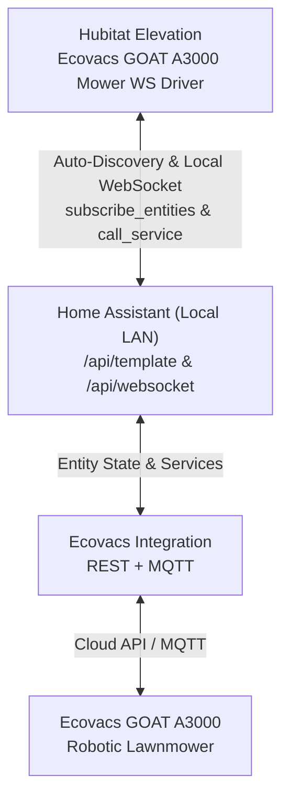

# Ecovacs GOAT A3000 Mower for Hubitat Elevation

A standalone Hubitat Elevation driver that connects directly to a local **Home Assistant** instance over WebSocket (`subscribe_entities`) to monitor and control an **Ecovacs GOAT A3000** robotic lawnmower in real time—with zero polling overhead and automatic entity discovery.

---

## Architecture

Home Assistant handles Ecovacs cloud authentication and MQTT communication via its `ecovacs` (or HACS `ha-ecovacs-mower`) integration. Hubitat discovers all enabled entities attached to your mower device once via Home Assistant's `/api/template` endpoint, then maintains a persistent local LAN WebSocket connection for instant state push updates and command dispatch.



---

## Features

* **Zero-Config Entity Auto-Discovery:** Enter only your main `lawn_mower.*` entity ID. The driver queries Home Assistant for every enabled entity belonging to that mower device and subscribes to all of them automatically.
* **Dynamic Entity Support:** Known GOAT entities map to structured attributes automatically, while any additional enabled HA entities (or custom **Additional HA Entity IDs**) appear automatically as clean camelCase attributes in **Current States**.
* **Real-Time Push Updates:** Uses Home Assistant's `subscribe_entities` WebSocket API to receive only deltas for your mower entities, with thread-safe message ID tracking and clean re-subscription on refresh.
* **Resilient Connection:** Built-in `Initialize` capability for hub reboots, 30-second WebSocket keepalive pings, and exponential backoff reconnection.
* **Imperial & Metric Units:** Selectable **Measurement Units** preference (`Imperial` or `Metric`) with automatic bi-directional conversion for `areaMowed` (`sq ft` / `m²`) as well as auto-discovered area, length, and temperature entities.
* **Clean Formatting:** Formats `areaMowed` as a whole integer (`sq ft` or `m²`) and `mowingDuration` as integer hours and minutes (e.g., `452h 13m`).
* **Core Controls:** `startMowing`, `pause`, `stop`, `dock`, `setCutDirection`, and standard `Switch` (`on` = start mowing, `off` = return to dock) for Rule Machine and Dashboards.
* **Per-Zone Mowing (3 Modes):** Trigger specific lawn zones via Home Assistant Scripts, an auto-discovered or manual `select.*` entity, or a custom HA service call.
* **Auto-Shutoff Debug Logging:** Debug logs automatically disable after 30 minutes to keep Hubitat logs clean.

---

## Prerequisites

1. An Ecovacs GOAT A3000 configured in Home Assistant using the official [Ecovacs integration](https://www.home-assistant.io/integrations/ecovacs) or a community GOAT integration (such as `ha-ecovacs-mower`).
2. A Home Assistant **Long-Lived Access Token** (HA Profile → **Security** → **Long-Lived Access Tokens** → **Create Token**).
3. *(Optional)* In Home Assistant under **Settings → Devices & services → Ecovacs → [Your Mower]**, enable any diagnostic entities that are disabled by default (such as **Error**, **Cutting direction**, or **Wi-Fi signal strength**). Click **Refresh** in Hubitat afterward to pick them up automatically.

---

## Installation

### Option A: Hubitat Package Manager (Recommended)
1. Open **Hubitat Package Manager (HPM)** in Hubitat.
2. Select **Install → From a URL**.
3. Paste the manifest URL:
   ```text
   [https://raw.githubusercontent.com/kurtsanders/Hubitat-Ecovacs-GOAT-Mower/main/packageManifest.json](https://raw.githubusercontent.com/kurtsanders/Hubitat-Ecovacs-GOAT-Mower/main/packageManifest.json)
   ```
4. Follow the prompts to complete installation.

### Option B: Manual Installation
1. In Hubitat, go to **Drivers Code → + New Driver**.
2. Click **Import**, paste the raw Groovy URL below, and click **Import** → **Save**:
   ```text
   [https://raw.githubusercontent.com/kurtsanders/Hubitat-Ecovacs-GOAT-Mower/main/drivers/Ecovacs_GOAT_A3000_Mower_WS.groovy](https://raw.githubusercontent.com/kurtsanders/Hubitat-Ecovacs-GOAT-Mower/main/drivers/Ecovacs_GOAT_A3000_Mower_WS.groovy)
   ```

---

## Device Setup

1. Go to **Devices → Add Device → Virtual**.
2. Enter a device name (e.g., `Billie Goat WS`) and set **Type** to **Ecovacs GOAT A3000 Mower WS**.
3. Click **Save Device**, then configure the **Preferences**:
   * **Home Assistant IP / Port / Token:** Your local HA server details (and TLS toggle if using `https://`/`wss://`).
   * **Lawn Mower Entity ID:** Required (e.g., `lawn_mower.outside_billie_goat_3000`).
   * **Auto-discover all enabled HA entities:** Enabled by default—automatically pulls in battery, rain sensor, error, blade life, mowed area, mowing duration, cut direction, RSSI, last job, and any other enabled entities on the mower device.
   * **Additional HA Entity IDs (Optional):** Comma-separated list of any extra HA entities (such as an external weather/rain sensor) you also want mirrored on this device.
   * **Measurement Units:** Choose **Imperial (`sq ft, in, ft, °F`)** or **Metric (`m², cm, m, °C`)**.
4. Click **Save Preferences**. `connectionStatus` will transition to `connected`, `discoveredEntityCount` will report the number of subscribed entities, and **Current States** will populate immediately.

---

## Commands & Attributes

### Commands
| Command | Parameters | Description |
| :--- | :--- | :--- |
| `startMowing` / `on` | None | Calls `lawn_mower.start_mowing` |
| `dock` / `off` | None | Calls `lawn_mower.dock` |
| `pause` | None | Calls `lawn_mower.pause` |
| `stop` | None | Calls `lawn_mower.stop` |
| `mowZone` | `zoneName` (String) | Dispatches mapped zone via configured Zone Mode |
| `setCutDirection` | `degrees` (0–180) | Sets auto-discovered HA `number.*` cutting direction entity |
| `refresh` | None | Re-runs entity discovery and re-subscribes for a fresh snapshot |
| `connect` / `disconnect` | None | Manually open or close the HA WebSocket |

### Key Attributes
| Attribute | Values / Unit | Notes |
| :--- | :--- | :--- |
| `mowerState` | `mowing`, `docked`, `paused`, `returning`, `error` | Mirrors HA `lawn_mower` state |
| `switch` | `on` / `off` | `on` when actively mowing, `off` otherwise |
| `battery` | `%` | From battery sensor or mower attribute |
| `hasError` | `true` / `false` | Rule Machine trigger flag for non-zero errors |
| `errorCode` / `errorDescription` | String | Numeric code and human-readable HA description |
| `rainStatus` | `wet` / `dry` / `unknown` | Normalized rain sensor state (avoids triggering HSM leak alerts) |
| `bladeLife` | `%` | Remaining blade lifespan |
| `areaMowed` | Integer (`sq ft` or `m²`) | Auto-converted based on **Measurement Units** preference |
| `mowingDuration` | String (e.g., `452h 13m`) | Total mowing time formatted in integer hours and minutes |
| `cutDirection` | `°` (0–180) | Current cutting angle |
| `rssi` | `dBm` | Mower Wi-Fi signal strength |
| `lastJobReason` | String | Stop reason from HA `event.*` entity |
| `discoveredEntityCount` | Number | Total HA entities currently subscribed |
| `connectionStatus` | `connected`, `connecting`, `disconnected`, `auth_failed` | WebSocket link status |

---

## Per-Zone Mowing Configuration

Choose one of three modes in **Preferences**:

1. **HA Script Mode (Default):** Map friendly zone names to Home Assistant scripts in **Zone Map**, e.g.:
   ```text
   Front=script.mow_front_yard, Back=script.mow_back_yard
   ```
2. **HA Select Entity + Start Mowing:** Uses an auto-discovered `select.*zone*` entity (or a manually specified `select.*` entity) and maps zone names to option labels:
   ```text
   Front=Front Yard, Back=Back Yard
   ```
3. **Custom HA Service Call:** Specify any HA `domain.service` and parameter key (e.g., `zone_id`), and map zone names to IDs.

In **Rule Machine**, invoke zone mowing via **Run Custom Action → Actuator → `mowZone`** with a string parameter (e.g., `Front`).

---

## Change History

* **v1.1.1 (2026-11-22):** Added Imperial/Metric `unitSystem` preference with bi-directional conversion for `areaMowed` and auto-discovered area, length, and temperature entities.
* **v1.1.0 (2026-11-22):** Added automatic HA device entity discovery via `/api/template`; eliminated manual sensor entity entry and added dynamic camelCase attribute creation for extra entities.
* **v1.0.2 (2026-11-22):** Fixed HA WebSocket `id_reuse` errors using a thread-safe `@Field` `AtomicInteger` counter and clean `unsubscribe_events` on refresh.
* **v1.0.1 (2026-11-22):** Formatted `areaMowed` as integer `sq ft` and `mowingDuration` as integer hours and minutes (`Xh Ym`).
* **v1.0.0 (2026-11-22):** Initial public release.

---

## License

Apache License 2.0 — Copyright © 2026 Kurt Sanders (SanderSoft).